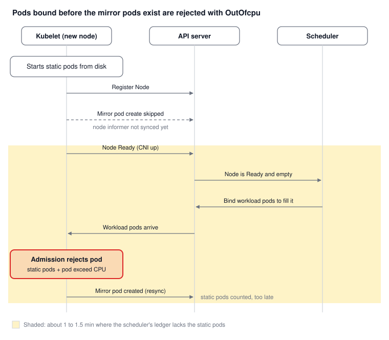
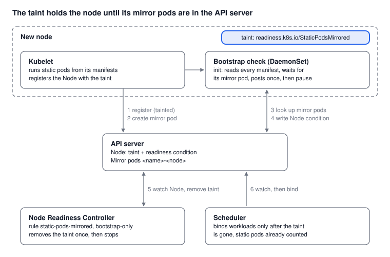

# Closing the static-pod race with Node Readiness Controller

Pods failing with `OutOfcpu` on a new node right after a scale-up are a known race condition in Kubernetes ([kubernetes/kubernetes#115325](https://github.com/kubernetes/kubernetes/issues/115325)). This happens because the scheduler assigns pods to the node before the node's static pods are accounted for. As a result, the kubelet rejects the pods at admission and marks them `Failed`. Since these pods are already bound to the node, they cannot be rescheduled to other nodes or trigger the autoscaler to add capacity.

This example shows how to fix this race condition with a `bootstrap-only` `NodeReadinessRule`.

> All manifests referenced in this guide are available in the [`examples/staticpods-readiness`](https://github.com/kubernetes-sigs/node-readiness-controller/tree/0eeaf090fccf3a333ef650f3681bec4d2fb31ab8/examples/staticpods-readiness) directory.

## What goes wrong

The kubelet starts static pods (such as `kube-proxy`) from files on disk and counts their resources immediately. The scheduler counts them only once their mirror pod (`<pod>-<node>`) appears in the API server, which can be a minute or more after the node is `Ready`. In that window the scheduler sees capacity that isn't there and overfills the node.

If no static pods on your nodes request resources, you are not affected.



[kubernetes/kubernetes#126870](https://github.com/kubernetes/kubernetes/pull/126870) creates mirror pods earlier, which shortens the window but doesn't remove it.

## How the fix works

1. The kubelet registers the node with the taint `readiness.k8s.io/StaticPodsMirrored=pending:NoSchedule`.
2. A DaemonSet pod that tolerates the taint waits until every static pod on the node has a mirror pod, then sets `readiness.example.com/StaticPodsMirrored=True`.
3. NRC removes the taint and stops evaluating the node (`bootstrap-only`).
4. The scheduler sees the node's real capacity. Pods that don't fit stay `Pending` for the autoscaler.



Every new node, including replacements, is held once.

## Step 1: Register nodes with the taint

Set the taint at registration with the kubelet flag `--register-with-taints`. With kubeadm:

```yaml
kind: JoinConfiguration
nodeRegistration:
  kubeletExtraArgs:
    register-with-taints: "readiness.k8s.io/StaticPodsMirrored=pending:NoSchedule"
```

Managed platforms expose this as node pool or node group taints. With Karpenter, use `startupTaints`.

## Step 2: Deploy the check

The init container runs [`wait-for-mirrors.sh`](https://github.com/kubernetes-sigs/node-readiness-controller/blob/0eeaf090fccf3a333ef650f3681bec4d2fb31ab8/examples/staticpods-readiness/wait-for-mirrors.sh). For each manifest in the static pod directory it waits until the mirror pod `<name>-<node>` exists, then sets the condition.

```bash
#!/bin/bash
# wait-for-mirrors.sh: init container of the static-pod-mirror-check DaemonSet.
# Waits until every static pod on this node has a mirror pod in the API server,
# then sets the Node condition that the NodeReadinessRule watches, and exits.
set -euo pipefail
MANIFEST_DIR="${MANIFEST_DIR:-/etc/kubernetes/manifests}"
CONDITION="${CONDITION:-readiness.example.com/StaticPodsMirrored}"
: "${NODE_NAME:?set NODE_NAME from spec.nodeName}"
log() { echo "$(date -u +%FT%TZ) [StaticPodMirrorCheck] $*"; }

while :; do
  missing=""
  for f in "$MANIFEST_DIR"/*; do
    [[ -f "$f" && "$(basename "$f")" != .* ]] || continue   # the kubelet skips dotfiles
    read -r name ns <<< "$(kubectl patch --local -f "$f" -p '{}' \
      -o jsonpath='{.metadata.name} {.metadata.namespace}' 2>/dev/null || true)"
    if [[ -z "${name:-}" ]]; then
      missing+=" $(basename "$f")(unparsed)"
      continue
    fi
    mirror="${ns:-default}/$name-$NODE_NAME"
    if ! out="$(kubectl get pod "$name-$NODE_NAME" -n "${ns:-default}" -o name 2>&1)"; then
      [[ "$out" == *NotFound* ]] || log "lookup of $mirror failed: $out"
      missing+=" $mirror"
    fi
  done
  [[ -z "$missing" ]] && break
  log "waiting for mirror pods:$missing"
  sleep 2
done

now="$(date -u +%FT%TZ)"
until kubectl apply --server-side --subresource=status --field-manager=static-pod-mirror-check -f - >/dev/null <<EOF
{"apiVersion":"v1","kind":"Node","metadata":{"name":"$NODE_NAME"},"status":{"conditions":[{"type":"$CONDITION","status":"True",
 "reason":"MirrorPodsRegistered","message":"All static pods have mirror pods in the API server","lastHeartbeatTime":"$now","lastTransitionTime":"$now"}]}}
EOF
do sleep 2; done
log "set $CONDITION=True on $NODE_NAME"
```

Build the image from the [`Dockerfile`](https://github.com/kubernetes-sigs/node-readiness-controller/blob/0eeaf090fccf3a333ef650f3681bec4d2fb31ab8/examples/staticpods-readiness/Dockerfile):

```dockerfile
FROM alpine:3.22
RUN apk add --no-cache bash kubectl
COPY wait-for-mirrors.sh /
```

[`daemonset.yaml`](https://github.com/kubernetes-sigs/node-readiness-controller/blob/0eeaf090fccf3a333ef650f3681bec4d2fb31ab8/examples/staticpods-readiness/daemonset.yaml) runs it:

```yaml
apiVersion: v1
kind: ServiceAccount
metadata: {name: static-pod-mirror-check, namespace: kube-system}
---
apiVersion: rbac.authorization.k8s.io/v1
kind: ClusterRole
metadata: {name: static-pod-mirror-check}
rules:
  - {apiGroups: [""], resources: [pods], verbs: [get]}
  - {apiGroups: [""], resources: [nodes/status], verbs: [patch]}
---
apiVersion: rbac.authorization.k8s.io/v1
kind: ClusterRoleBinding
metadata: {name: static-pod-mirror-check}
roleRef: {apiGroup: rbac.authorization.k8s.io, kind: ClusterRole, name: static-pod-mirror-check}
subjects: [{kind: ServiceAccount, name: static-pod-mirror-check, namespace: kube-system}]
---
apiVersion: apps/v1
kind: DaemonSet
metadata: {name: static-pod-mirror-check, namespace: kube-system}
spec:
  selector:
    matchLabels: {app: static-pod-mirror-check}
  template:
    metadata:
      labels: {app: static-pod-mirror-check}
    spec:
      serviceAccountName: static-pod-mirror-check
      priorityClassName: system-node-critical
      nodeSelector: {kubernetes.io/os: linux}   # same nodes as the rule
      tolerations:
        - operator: Exists                       # must run on held nodes
      initContainers:
        - name: wait-for-mirrors
          image: <your-registry>/static-pod-mirror-check:v1
          command: [bash, /wait-for-mirrors.sh]
          env:
            - name: NODE_NAME
              valueFrom: {fieldRef: {fieldPath: spec.nodeName}}
          resources:
            requests: {cpu: 10m, memory: 32Mi}
            limits: {memory: 128Mi}
          volumeMounts:
            - {name: manifests, mountPath: /etc/kubernetes/manifests, readOnly: true}
      containers:
        - name: idle
          image: registry.k8s.io/pause:3.10
          resources:
            requests: {cpu: 1m, memory: 8Mi}
            limits: {memory: 8Mi}
      volumes:
        - name: manifests
          hostPath: {path: /etc/kubernetes/manifests, type: Directory}
```

Set the `hostPath` to your kubelet's `staticPodPath`. The ClusterRole can patch any Node's status; to restrict each pod to its own node, see the [constrained impersonation example](./constrained-impersonation.md) (Kubernetes 1.35+).

## Step 3: Create the rule

[`staticpods-readiness-rule.yaml`](https://github.com/kubernetes-sigs/node-readiness-controller/blob/0eeaf090fccf3a333ef650f3681bec4d2fb31ab8/examples/staticpods-readiness/staticpods-readiness-rule.yaml):

```yaml
apiVersion: readiness.node.x-k8s.io/v1alpha1
kind: NodeReadinessRule
metadata:
  name: static-pods-mirrored
spec:
  nodeSelector:
    matchLabels:
      kubernetes.io/os: linux
  conditions:
    - type: readiness.example.com/StaticPodsMirrored
      requiredStatus: "True"
  taint:
    key: readiness.k8s.io/StaticPodsMirrored
    effect: NoSchedule
  enforcementMode: bootstrap-only
```

`defaultStatus` is `Unknown` by default, so nodes wait for the `readiness.example.com/StaticPodsMirrored` condition.

## What to expect

- A node with no static pods passes immediately.
- If a static pod never gets a mirror pod (for example, an invalid manifest), the node stays tainted and the check logs the missing pod.
- Pods that tolerate the taint, such as CNI or log agent DaemonSets, are not held.
- A reboot reruns the check. It has no effect once the rule has released the node.

## Rolling it out

Create the DaemonSet and the rule before you create node groups or nodes with the taint.

Caveats:

1. Configure your autoscaler to treat the readiness taint as a startup taint: Karpenter [`startupTaints`](https://karpenter.sh/docs/concepts/nodepools/#spectemplatespecstartuptaints), Cluster Autoscaler [`--startup-taint-prefix`](https://github.com/kubernetes/autoscaler/blob/master/cluster-autoscaler/FAQ.md#how-does-cluster-autoscaler-treat-nodes-with-statusstartupignore-taints).
2. `bootstrap-only` rules only handle the taint at node bootstrap. The controller does not manage taints you change on the node after bootstrap.

## Checking that it works

Size a ReplicaSet to exactly fill a node, pin it to a node group, and scale the group from 3 to 20 nodes. Without the gate you'll see `OutOfcpu` pods; with it, none:

```bash
kubectl get pods -A --field-selector status.phase=Failed -o json \
  | jq '[.items[] | select(.status.reason == "OutOfcpu")] | length'
```

Watch the taint appear at registration and go once the condition turns `True`:

```bash
kubectl get nodes -w -o custom-columns='NAME:.metadata.name,MIRRORED:.status.conditions[?(@.type=="readiness.example.com/StaticPodsMirrored")].status,TAINTS:.spec.taints[*].key'
```

A held node's check pod sits in `Init:0/1`. Its log names the mirror pod it is waiting for:

```bash
kubectl logs -n kube-system -l app=static-pod-mirror-check -c wait-for-mirrors --prefix | tail
```

If you scrape NRC's metrics, alert on `node_readiness_rule_nodes{rule="static-pods-mirrored",state="held"} > 0` for ten minutes.

The same pattern works for any "not ready until X exists" check.
